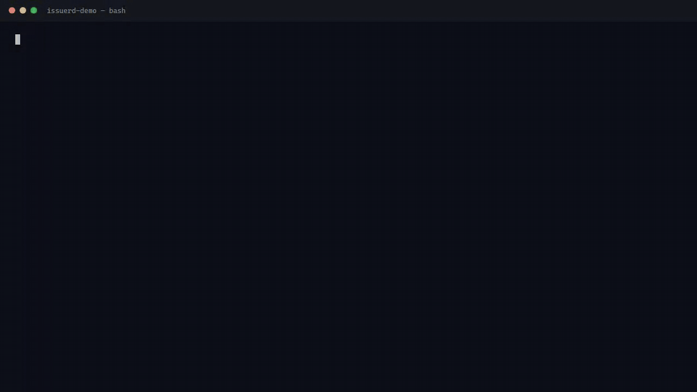

<p align="center">
  <picture>
    <source media="(prefers-color-scheme: dark)" srcset=".github/assets/white-logo.svg">
    
  </picture>
</p>

<p align="center">
  <strong>Fast, Keycloak-compatible IAM with DPoP and CIBA — OpenID Certified OIDC/OAuth2 in Rust, shipped as a single binary, horizontally scalable.</strong>
</p>

<p align="center">
  <a href="https://github.com/issuerd/issuerd/actions/workflows/ci.yml"></a>
  <a href="LICENSE"></a>
  <a href="https://www.rust-lang.org/"></a>
  <a href="https://openid.net/certification/certified-openid-connect-implementations/?cache=2026-10-23"></a>
  <a href="https://github.com/rust-secure-code/safety-dance"></a>
  <a href="https://github.com/issuerd/issuerd/tree/badges"></a>
  <a href="https://github.com/issuerd/issuerd/tree/badges"></a>
  <a href="https://issuerd.org"></a>
  <a href="https://crates.io/crates/issuerd"></a>
  <a href="https://hub.docker.com/r/issuerd/issuerd"></a>
</p>

> **Proof, not promises:** OpenID Certified across 11 OP profiles (10 on v0.1.17 + RP-Initiated Logout on v0.1.19) · 31,000+ self-hosted conformance conditions with zero unexpected failures or warnings · 71 curated MCP tools · 3,460+ automated tests.

Issuerd is a modular Identity and Access Management server implementing OpenID Connect and OAuth 2.x. It combines the realm model and Admin API shape familiar from Keycloak with a Rust runtime, embedded admin and account consoles, and deployment as one self-contained binary.

**[Live demo](https://demo.issuerd.org)** · **[Quickstart](#quickstart)** · **[Documentation](docs/README.md)** · **[Performance](docs/PERFORMANCE.md)**

<p align="center"></p>

## Why Issuerd?

- **OpenID Certified, not merely spec-inspired.** The official registries list 10 OP profiles on v0.1.17 and RP-Initiated Logout OP on v0.1.19. These entries are version-specific and do not certify v0.2.x. Every release separately ships fresh self-hosted conformance evidence.
- **Keycloak-compatible where it counts.** Realms, clients, roles, scopes, protocol mappers, authentication flows, and the Admin REST API follow the Keycloak model. A dual-target suite runs the same assertions against Issuerd and a live Keycloak 24.0; every deliberate difference is [documented](tests/KEYCLOAK_DIFFS.md).
- **Built for agent authorization.** DPoP sender-constraining, RFC 8693 per-call audience/scope attenuation, and CIBA human approval are implemented and exercised in live demos, not just listed on a roadmap.
- **One Rust binary, several storage modes.** Use PostgreSQL for shared production state and clusters, embedded SQLite for durable single-node deployments without an external database, or in-memory/JSON backends for development and test rigs. No JVM is required.
- **Full IAM operations.** SSO, MFA and passkeys, LDAP/Kerberos federation, identity brokering, self-service account management, declarative provisioning, OpenAPI export, audit events, metrics, and health probes are included under Apache-2.0.
- **Measured and reproducible.** Benchmarks cover throughput, latency, memory, storage, and agentic workloads against Keycloak 26.7. The [methodology and current results](docs/PERFORMANCE.md) are public, including limitations and scenarios where behavior differs.

## Agent-first authorization

Bearer tokens and broad admin credentials are a poor fit for agents that read untrusted input and call many tools. Issuerd enforces the boundary on the server:

- **DPoP (RFC 9449):** access tokens can be bound to the holder's key, with method/URL-bound, short-lived proofs and distributed replay protection.
- **Token exchange (RFC 8693):** each downstream call can receive a fresh audience-narrowed, scope-attenuated token. Scope can only shrink, and DPoP binding survives the exchange.
- **CIBA step-up:** a strict action requires a fresh human decision for an exact operation, followed by a short-lived, single-purpose token. No standing high-privilege agent credential is needed.

| MCP scenario: attenuated, sender-constrained tool calls | CIBA scenario: human step-up approval |
|---|---|
|  |  |
| Login → narrowed token → orders listed → injection changes nothing → replay rejected with **401** | Refund requested → exact approval → short-lived grant → refund applied → same call without it: **403** |

### Built-in MCP administration

Issuerd also exposes a realm-scoped MCP server with **71 curated administration and self-service tools plus three redacted resources**. Reads and reversible writes stay within explicit scopes and roles. Strict operations bind fresh approval to canonical `tool + arguments` and expected state; changed arguments fail, and exact retries reconcile the recorded result without a second mutation.

Guides: [MCP server](docs/mcp-server.md) · [Exact-operation approval](docs/mcp-exact-operation-approval.md) · [Official-SDK acceptance example](examples/mcp-admin/) · [External DPoP/token-exchange demo](docs/agentic-iam-mcp.md)

## OIDC conformance

The accepted OIDF-hosted submissions used the OpenID Foundation Conformance Suite release v5.3.3:

| Certified version | Certified OP profiles |
|---|---|
| **v0.1.17** | Config, Basic, Implicit, Hybrid, Dynamic, 3rd Party-Init, Form Post, Session Management, Front-Channel Logout, Back-Channel Logout |
| **v0.1.19** | RP-Initiated Logout |

Across those submissions, **524 modules finished: 393 PASSED, 41 declared SKIPPED, and 90 REVIEW with screenshots, with no FAILED or INTERRUPTED results**. The broader self-hosted matrix covers **43 plan invocations, 612 modules, and 31,000+ conditions**, with zero unexpected failures and zero unexpected warnings in the recorded run.

Every [GitHub Release](https://github.com/issuerd/issuerd/releases) re-runs that matrix against the tagged commit and attaches HTML reports, JSON exports, and runner logs as `issuerd_<version>_conformance-evidence.tar.gz`, covered by checksums, signatures, and a build-provenance attestation. This is continuous engineering evidence, not a new certification for each release.

Details and reproduction: [conformance and certification guide](docs/openid-conformance.md) · [hermetic harness](tests/conformance/README.md) · [per-module coverage](tests/conformance/COVERAGE.md)

## Quickstart

### Try the hosted demo

Explore [demo.issuerd.org](https://demo.issuerd.org) for the consoles, OIDC/OAuth2 flows, federation, DPoP, CIBA, and MCP administration. The playground uses synthetic data only, is best-effort, and may be reset; do not enter real passwords or sensitive data. App 11 provides a read-only observer and an operator with exact-operation approval.

### Docker demo stack

From a repository checkout:

```bash
docker compose up
```

This starts Issuerd, PostgreSQL, and Redis on `http://localhost:8080`, with the `master` realm (admin `admin` / `admin`) and demo realm `myrealm` (user `alice` / `changeme`). No build tools are required.

- **Admin console:** <http://localhost:8080/admin/console>
- **Account console:** <http://localhost:8080/realms/myrealm/account>
- **Discovery:** <http://localhost:8080/realms/myrealm/.well-known/openid-configuration>

Stop with `docker compose down`; wipe the local demo data with `docker compose down -v`.

### Build from source

Prerequisites: Rust 1.95+ and Node.js 20+ for the embedded browser consoles.

```bash
cd webclientsrc && npm ci && npm run generate-api && npm run build && cd ..
cargo run --bin issuerd -- daemon
```

The checked-in development rig listens on `http://localhost:8080` and uses in-memory storage. For durable single-node storage without PostgreSQL, configure `[storage.sqlite]` as described in [Configuration](docs/configuration.md#storage).

Prebuilt archives for **Linux, Windows, and macOS**, SBOMs, checksums, signatures, and conformance evidence are attached to every [GitHub Release](https://github.com/issuerd/issuerd/releases). See [Getting started](docs/getting-started.md) for a verified first token and [Deployment](docs/deployment.md) for production topologies.

## Architecture and quality

The workspace contains **10 library crates plus the `issuerd` binary**, with a strictly acyclic dependency graph and `issuerd-server` as the composition root. See [ARCHITECTURE.md](ARCHITECTURE.md) and [AGENTS.md](AGENTS.md) for module contracts.

- **3,460+ automated tests**, including protocol, storage, federation, cluster, and MCP acceptance coverage.
- **Dual-target Keycloak oracle** for behavior and JSON/API compatibility.
- **Real-service test rigs** for Samba AD, OpenLDAP, PostgreSQL, Redis, and multi-node operation.
- **Strict CI gates:** formatting, clippy with warnings denied, docs, audits, web-client tests, coverage, and heavy Docker suites.
- **Backward compatibility:** append-only migrations, additive APIs, and optional configuration fields with safe defaults. Existing deployments must keep booting unchanged.

## Documentation

| Document | Purpose |
|---|---|
| [Operations documentation](docs/README.md) | Installation, configuration, provisioning, deployment, administration, federation, security, backup, and troubleshooting |
| [Getting started](docs/getting-started.md) | Local installation, first login, and a verified first token |
| [Configuration](docs/configuration.md) | Server, storage, TLS, cache, cluster, SMTP, and environment settings |
| [MCP server](docs/mcp-server.md) | The 71-tool surface, resources, scopes, roles, and client operation |
| [Exact-operation approval](docs/mcp-exact-operation-approval.md) | Canonical approval, atomic execution, and replay reconciliation |
| [OpenID conformance](docs/openid-conformance.md) | Certification boundaries, hosted submissions, and self-hosted evidence |
| [Performance](docs/PERFORMANCE.md) | Benchmark methodology and measured results against Keycloak 26.7 |
| [Clustering](docs/CLUSTERING.md) | Shared state and multi-node deployment |
| [Architecture](ARCHITECTURE.md) | Crate graph and module contracts |
| [Keycloak differences](tests/KEYCLOAK_DIFFS.md) | Deliberate compatibility exceptions |
| [Changelog](CHANGELOG.md) | Release history and migration notes |

The same operational guides are published at **[issuerd.org](https://issuerd.org)**.

## Project scope

Deliberately not implemented for now: SAML 2.0, UMA/Authorization Services, FGAP, Organizations, FAPI 2.0 message signing, and CIBA ping/push modes. Do not infer support from a generic OIDC/OAuth2 label; the discovery document and documentation describe the actual surface.

## Contributing, security, and license

- Contributions: [CONTRIBUTING.md](CONTRIBUTING.md) and [Code of Conduct](CODE_OF_CONDUCT.md).
- Security reports: follow [SECURITY.md](SECURITY.md) for private reporting and supported versions.
- License: Apache-2.0; see [LICENSE](LICENSE) and [NOTICE](NOTICE).
- Trademark: the Issuerd name and logo are unregistered trademarks; see [TRADEMARK.md](TRADEMARK.md).

Copyright 2026 Dmitry Andreev <da@issuerd.org> and contributors.
